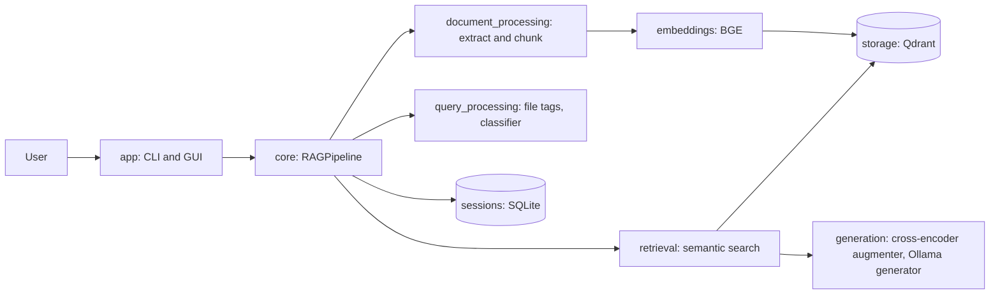

# SmartScholar

SmartScholar is a document-grounded study and research assistant. You point it at a folder of documents (PDF, DOCX or TXT). It indexes them into a local vector database, and you chat with a local LLM whose answers are built from passages retrieved from those documents.

## Implemented features

- Ingests PDF (PyMuPDF), DOCX (python-docx) and TXT files from a folder, called a "docset".
- Splits text into token-aware chunks with LangChain's `RecursiveCharacterTextSplitter`, using the tiktoken `cl100k_base` encoding, 500-token chunks and 50-token overlap.
- Embeds chunks with `BAAI/bge-base-en-v1.5` through sentence-transformers. Vectors are 768-dimensional and normalized.
- Stores vectors and metadata in a local Qdrant database with cosine distance.
- Retrieves semantically similar chunks above a 0.6 score threshold. If a query names files in the form `[[file.pdf]]`, it retrieves all chunks from those files instead.
- Re-ranks candidates with `cross-encoder/ms-marco-MiniLM-L-6-v2` and builds a context of up to 4096 tokens.
- Generates answers with a local model served by Ollama (`phi`). Prompts are written for five intents and ask the model to cite sources as `[Source X]`.
- Saves sessions and chat history in SQLite (`sessions.db`) and resumes them later.
- Provides a command-line interface and a CustomTkinter desktop GUI.

## Known limitations

These were verified from the source code.

- The query classifier is disabled. `query_processing/query_classifier.py` always returns `"general"`, so the intent-specific prompts are never selected. The BERT-based implementation is commented out.
- `scripts/training/train_query_classifier.py` can train a classifier, but the application does not load the resulting model.
- Only `generation/generator2.py` (Ollama) is active. `generation/generator.py` is an inactive Gemini alternative that nothing imports.
- `document_processing/folder_monitor.py` is not used by the application.
- Document chunks are embedded with the BGE query instruction prefix. Changing this requires re-indexing.
- `generation/augmenter.py` ranks chunks by multiplying cross-encoder scores by vector scores. Cross-encoder scores can be negative, which can reverse the ordering. This was left unchanged during restructuring.
- No automated tests cover Qdrant, Ollama or the GUI yet.

## Architecture



Module responsibilities are described in [docs/architecture/README.md](docs/architecture/README.md). Contributor setup is in [docs/development/README.md](docs/development/README.md). Model details are in [models/README.md](models/README.md).

## Repository structure

```
Smartscholar/
├── src/smartscholar/        Application package (import as `smartscholar.*`)
│   ├── app/                 CLI (main.py) and GUI (main_gui.py)
│   ├── core/                RAG orchestration and batch ingestion
│   ├── document_processing/ File extraction, chunking, folder monitor (unused)
│   ├── embeddings/          BGE embedder
│   ├── generation/          Cross-encoder augmenter and generators
│   ├── query_processing/    File-tag extraction and query classifier
│   ├── retrieval/           Semantic retriever
│   ├── sessions/            SQLite session manager
│   ├── storage/             Qdrant vector store
│   └── config.py            Project-root-relative paths
├── scripts/training/        Operational scripts (classifier training)
├── models/                  Notes on model weights (weights live in local/, git-ignored)
├── data/datasets/           Datasets
├── tests/unit/              Automated tests that need no external services
├── tests/fixtures/          Test data
├── docs/                    Architecture and development guides
├── examples/                Usage examples (none yet)
├── pyproject.toml
└── requirements.txt
```

## Installation

Requirements: Python 3.10 or newer (not verified against every dependency), and [Ollama](https://ollama.com) with the `phi` model.

```bash
python -m venv .venv
# Windows: .venv\Scripts\activate     macOS/Linux: source .venv/bin/activate
pip install -e .
ollama pull phi
```

The embedding model and the cross-encoder download automatically on first use into `local/`. Downloads need internet access.

## Running

```bash
python -m smartscholar.app.main                 # command-line interface
python -m smartscholar.app.main_gui             # desktop GUI
python -m smartscholar.core.preprocessing_pipeline   # index a folder from the terminal
```

Start Ollama before querying (`ollama serve` if it is not already running as a service).

## Configuration

Paths are resolved from the project root, not the current directory. Override them with environment variables if needed.

| Variable | Default | Purpose |
|---|---|---|
| `SMARTSCHOLAR_MODELS_DIR` | `<root>/local` | Downloaded model weights |
| `SMARTSCHOLAR_QDRANT_DIR` | `<root>/qdrant_vdb` | Qdrant database |
| `SMARTSCHOLAR_SESSIONS_DB` | `<root>/sessions.db` | Session and chat history |
| `GEMINI_API_KEY` | none | Only for the inactive Gemini generator |

Copy `.env.example` to `.env` for local settings. Never commit `.env`.

## Dataset

`data/datasets/query_classifier_dataset.csv` has 999 rows with the columns `query` and `category`. The category counts are: conceptual 266, technical 235, explanatory 223, general 160, factual 115. The origin and license of the data are not documented.

## Testing

```bash
pip install pytest
pytest
```

The unit tests run without Qdrant, Ollama or downloaded models. Integration tests do not exist yet. See [tests/README.md](tests/README.md).

## Data safety

`sessions.db` holds your conversation history. Keep it and do not overwrite it. A Qdrant collection must keep its 768-dimensional BGE vectors. Changing the embedding model requires re-indexing.

## License

No `LICENSE` file was present in the archive used for this restructuring. The maintainer should add one before others reuse the code.

## Future improvements

Enable and test the query classifier, or remove it. Add integration tests for Qdrant, Ollama and the GUI. Review the ranking formula in `augmenter.py`. Move model weights from `local/` to a documented `models/` location. Document or remove `folder_monitor.py`.
